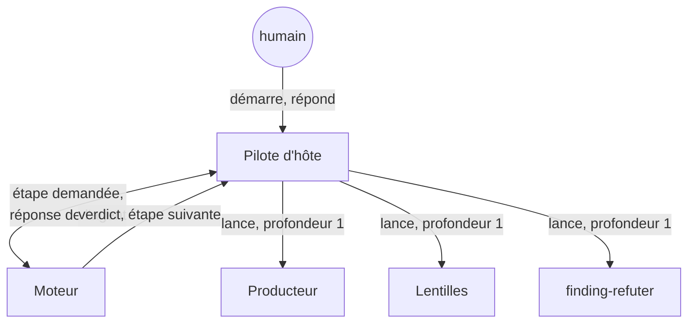

# L'équipe — le pipeline comme une course de relais

Des agents qui produisent, des lentilles qui jugent, un moteur qui décide et un pilote qui
lance. Personne ne valide son propre travail, et aucun agent n'en lance un autre.

## Quatre rôles, jamais confondus

SKRAFT n'est pas un agent monolithique. Le travail se répartit entre quatre rôles, et chacun
ne fait que le sien.

- **Les producteurs** écrivent un artefact : `solution-researcher` (RESEARCH),
  `solution-architect` (DESIGN), `acceptance-designer` (DISTILL), `software-engineer` (DELIVER),
  `pr-writer` (la prose de la pull request).
- **Les juges** lisent sans rien modifier : les lentilles de revue, chacune sur un seul angle,
  et `finding-refuter`, qui confirme ou réfute chaque finding qui renverrait le travail.
- **Le moteur** décide : l'étape suivante, ce que l'agent reçoit, la sortie attendue, les
  gates, le verdict d'une revue. C'est du code testé, le même sur tous les hôtes.
- **Le pilote d'hôte** exécute : le mod Claude Code, le workflow Copilot ou la boucle d'agent
  de VS Code lance l'agent que le moteur demande et lui rend la réponse.

Un cinquième acteur garde les décisions qui engagent l'équipe : **l'humain**. Il ratifie les
ADR, consent à la publication, choisit comment traiter les mutants survivants. Aucun agent ne
répond à sa place.

*Figure 1 — Qui lance qui dans le pipeline d'ingénierie : le pilote est le seul à lancer des
agents ; le moteur ne lance rien, il décide.*

## L'orchestrateur ne fait que démarrer

L'agent `skraft-orchestrator` est le point d'entrée que le développeur sélectionne, mais il ne
produit rien et ne décide de rien. Sous Claude Code, son seul outil démarre le pipeline ; sous
Copilot CLI, il lance le workflow `skraft-pipeline` ; sous VS Code sans SDK, il conduit la boucle
`skraft next` / `skraft record` et lance les agents que l'étape liste. Il relaie ensuite ce que
le run rapporte. En v1, l'ordre des phases et les verdicts vivaient dans sa prose ; en V2, ils
sont dans le moteur, et l'état du run dans le [journal d'événements](../event-journal.md).

## Pourquoi seul le pilote lance des agents

**Profondeur 1** : le pilote lance chaque agent, lentilles et réfuteur compris, et aucun agent
n'en lance un autre. En v1, le reviewer de DELIVER lançait lui-même ses lentilles, à
profondeur 2. Cela coûtait un contexte de plus, dupliquait des contrôles, et le comportement
dépendait de ce que chaque hôte permettait à un sous-agent.

À profondeur 1, le moteur voit chaque lancement dans son journal, le pilote peut lancer les
lentilles d'une revue en parallèle quand l'hôte le permet, et une lentille ne peut pas
déléguer son jugement. Le détail du mécanisme est dans
[Architecture](../architecture.md).

Deux cas sortent du pipeline d'ingénierie sans contredire la règle. Dans `skraft-backlog`, le
développeur lance `backlog-discoverer` ou `backlog-planner` comme agent principal de sa
session, et c'est ce producteur qui lance ses propres lentilles : aucun sous-agent n'en lance un
autre. Dans `skraft-brownfield`, `brownfield-refactorer`, lancé lui aussi comme agent principal,
peut confier du travail à `refactoring-worker`, qui ne lance personne.

## Personne ne valide son propre travail

DISCOVER, DISCUSS, DESIGN, DISTILL et DELIVER ont chacune leur revue, par des lentilles qui
n'ont pas produit le travail et qui tournent chacune dans un contexte neuf. RESEARCH fait
exception : le moteur vérifie que son document est rempli, et DESIGN en reste juge. C'est la
revue par les pairs appliquée à chaque relais
([Wiegers, 2002](../../reference/citations.mdx#cite-wiegers-peer-reviews-2002)).

## Sources

- [Wiegers, K. *Peer Reviews in Software*, 2002.](../../reference/citations.mdx#cite-wiegers-peer-reviews-2002)

## Voir aussi <!-- #see-also -->

- [Le fil rouge](./fil-rouge.md) — les relais sur un exemple.
- [Référence : phases](../../reference/phases.md) — producteur, lentilles et décision humaine de chaque phase.
- [Référence : hôtes](../../reference/hosts.md) — ce que chaque pilote lance et comment.
- [Le catalogue des agents](pathname:///dashboard/).
- [La revue avant la revue](../deep-dive/review-before-review.md).
