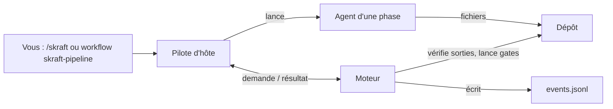

# SKRAFT — Le Handbook

SKRAFT conduit une story à travers quatre phases : **RESEARCH → DESIGN → DISTILL → DELIVER**.
En V2, un **moteur** unique décide de tout — ordre des phases, sorties attendues, relances,
verdicts, gates — et c'est le même sous Claude Code, GitHub Copilot CLI et VS Code.
Les **pilotes d'hôte** exécutent ce que le moteur demande et sont les seuls à lancer des agents ;
aucun agent n'en lance un autre, et aucun hook de commande ne ralentit vos appels d'outils.

> « The only way to go fast is to go well. »
> — Martin, R. C., *Clean Architecture*, 2017.

## Première visite

Suivez le [tutoriel Premiers pas](./tutorials/getting-started.md) : vous
installez le plugin, décrivez votre dépôt dans `skraft-config.json`, et menez une story de
RESEARCH à la description de sa pull request, sur un petit dépôt.

## Disponible aujourd'hui, et ce qui arrive {/* #roadmap */}
SKRAFT V2 se construit par **lots**, suivis dans l'epic [#211](https://github.com/SebastienDegodez/skraft-plugin/issues/211) et ses issues #212 à
#223. Ce tableau est la seule feuille de route du projet ; chaque lot arrive sur la branche
`integration/v2-next`, et une dernière pull request vers `main` livre la 2.0.0.

| Lot | Capacité | État |
| --- | --- | --- |
| 0 – 2 | Phase **RESEARCH** de bout en bout (document pré-créé, relance si manquant, arrêt au plafond), journal chaîné, reprise, `skraft-config.json` à composants, détection (`skraft init`), `skraft doctor`, base par dépôt, gates lancées à la main (`skraft gate`) | Disponible |
| 3 | DESIGN, DISTILL et DELIVER conduits par le moteur sur un workflow DOT ; droits d'écriture par diff git ; gates étapes du pipeline | Disponible |
| 4 | Revue du code par lentilles isolées, réfutateur, verdict calculé, re-revue incrémentale | Disponible |
| 5 | Décisions humaines (`skraft decide`, boîtes de dialogue, boutons du panneau), ratification d'ADR | Disponible |
| 6 | Agents et skills de la v1 élagués | Disponible |
| 7 | Boucle de clôture mutation (100 % cœur, 80 % frontière) | Disponible |
| 8 | Vue du panneau, rapports de run et QA, pull request de fin de run, publication des captures, progression sur l'issue | Disponible ; affichage du Canvas Copilot dans l'app à vérifier à la main |
| 9 | Plugin `skraft-brownfield` | Disponible |
| 10 | VS Code : pilote SDK Copilot, puis repli `skraft next` / `skraft record` | Disponible |
| 11 | `skraft migrate`, `skraft review --pr`, documentation V2, run de référence chronométré sur Mac et Windows, version 2.0.0 | `migrate` et `review --pr` disponibles ; documentation en cours ([#367](https://github.com/SebastienDegodez/skraft-plugin/issues/367)) ; run de référence et 2.0.0 à venir |

Hôtes disponibles aujourd'hui : **Claude Code** (commande `/skraft`, panneau « Skraft »),
**GitHub Copilot CLI** (workflows `skraft-pipeline` et `skraft-review`) et **VS Code** (SDK
Copilot, ou boucle d'agent de `skraft-orchestrator`).

## Comment lire ce handbook

La documentation suit **Diátaxis** : quatre portes selon ce que vous cherchez.

| Porte | Pour… | Pages |
| --- | --- | --- |
| **Apprendre** (tutoriel) | faire un premier parcours guidé | [Premiers pas](./tutorials/getting-started.md) |
| **Faire** (guide pratique) | réussir une tâche précise | [Installer skraft](./how-to/install-on-a-host.mdx), [Configurer les composants](./how-to/configure-components.md), [Lancer les gates](./how-to/run-gates.md), [Reprendre ou débloquer un run](./how-to/resume-a-run.md), [Répondre à une question](./how-to/answer-a-question.md), [Choisir les modèles](./how-to/choose-models.md), [Ajouter une lentille](./how-to/customise-review.md), [Publier la pull request](./how-to/publish-pull-request.md), [Évaluer un skill](./how-to/evaluate-a-skill.md), [Contribuer](./how-to/contributing.md) |
| **Consulter** (référence) | retrouver un fait exact | [Hôtes](./reference/hosts.md), [La ligne de commande `skraft`](./reference/cli.md), [Workflow DOT](./reference/workflow-dot.md), [Phases](./reference/phases.md), [`skraft-config.json`](./reference/skraft-config.md), [Journal du run](./reference/run-journal.md), [Glossaire](./reference/glossary.md), [Catalogue des agents et skills](pathname:///fr/dashboard/), [Gates](./reference/gates.md) |
| **Comprendre** (explication) | savoir *pourquoi* c'est construit ainsi | [Pour décideurs](./explanation/for-executives.md), [Architecture](./explanation/architecture.md), [Garde-fous](./explanation/guardrails.md), [Le journal d'événements](./explanation/event-journal.md), [Les phases](./explanation/pipeline/index.md), [Le backlog](./explanation/backlog.md), [Clean Architecture](./explanation/clean-architecture.md), [Outside-In TDD](./explanation/deep-dive/outside-in-tdd.md), [Brownfield](./explanation/brownfield.md) |

## Où aller selon votre rôle

- **Décideur** — le problème que la V2 résout et les objectifs visés :
  [Pour décideurs](./explanation/for-executives.md).
- **Développeur** — d'abord le [tutoriel](./tutorials/getting-started.md),
  puis les guides : [configurer les composants](./how-to/configure-components.md),
  [lancer les gates](./how-to/run-gates.md),
  [reprendre ou débloquer un run](./how-to/resume-a-run.md).
- **Architecte** — moteur, pilotes d'hôte, profondeur 1 :
  [Architecture](./explanation/architecture.md).
- **Qualification** — où sont les preuves et comment les lire :
  [Lancer les gates](./how-to/run-gates.md),
  [Journal du run](./reference/run-journal.md).

## SKRAFT V2 en une image

Le moteur ne lance jamais d'agent ; il dit au pilote quoi lancer, vérifie ce que l'agent a écrit,
puis journalise chaque étape dans `.copilot-tracking/skraft-plans/<slug>/events.jsonl`.
