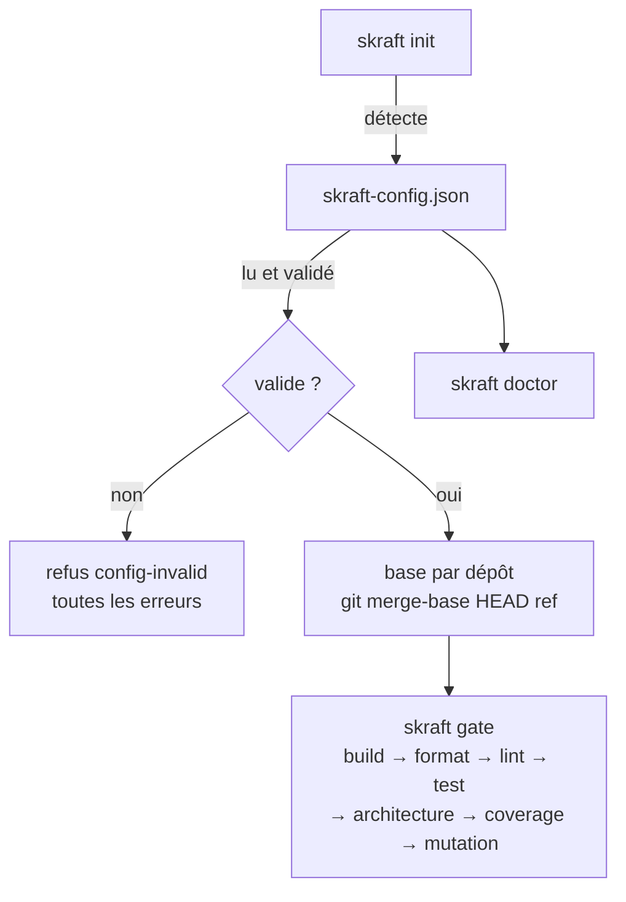

# skraft-config.json

`skraft-config.json` dit au moteur de quels composants est fait le dépôt et quelles commandes, toujours celles écrites par le développeur, les construisent et les testent.

Comment décrire les composants d'un dépôt pas à pas : [Configurer les composants](../how-to/configure-components.md). Pourquoi des commandes écrites dans un fichier versionné plutôt que devinées : [Architecture](../explanation/architecture.md).

## Emplacement <!-- #location -->

Le fichier se trouve **à la racine du dépôt qui lance le run** (la copie de travail), à côté
de `.copilot-tracking/`. Un fichier absent n'est pas une erreur : il vaut une config sans
composant. `skraft init` sans slug le crée ou le complète.

La configuration lue est la fusion de quatre couches, chacune un JSON Merge Patch (RFC 7386)
sur les précédentes ; un `null` retire ce qu'une couche inférieure a posé :

| Ordre | Couche | Versionnée | Peut contenir |
| --- | --- | --- | --- |
| 1 | défauts du plugin | — | `models`, `assign` |
| 2 | `~/.skraft/config.json` (dossier personnel du développeur) | non | toute clé sauf `components` |
| 3 | `skraft-config.json` (racine de la copie de travail) | oui | toutes les clés |
| 4 | `skraft-config.local.json` (à côté du précédent) | non | toute clé sauf `components` |

Chaque fichier est validé seul, puis la fusion est validée. Schémas JSON :
`schemas/skraft-config.schema.json` et `schemas/skraft-config.local.schema.json` dans le
plugin.



## Exemple <!-- #example -->

```json
{
  "baseBranch": "main",
  "components": [
    { "name": "api", "root": "services/payment-api", "stack": "dotnet",
      "paths": { "src": ["src/"], "tests": ["tests/"] },
      "commands": { "build": "dotnet build --nologo", "test": "dotnet test --nologo",
                    "format": "dotnet format --verify-no-changes",
                    "mutation": "dotnet stryker --since:{baseSha}" } },
    { "name": "web", "root": "../payment-web", "stack": "react", "baseBranch": "develop",
      "mocking": { "strategy": "inprocess" },
      "commands": { "build": "npm run build", "lint": "npm run lint", "test": "npm test" } }
  ]
}
```

## Schéma — premier niveau <!-- #top-level -->

| Clé | Type | Défaut | Règle |
| --- | --- | --- | --- |
| `baseBranch` | string | absent (la base retombe sur `main`) | ref git : sans blanc, ne commence pas par `-` ; `null` vaut absent |
| `forge` | string | absent (déduite du remote Git, voir [Forge](#forge)) | `github` ou `azure-devops` ; `null` vaut absent. Une valeur écrite par vous l'emporte toujours sur le remote |
| `components` | array d'objets | `[]` | chaque entrée est un composant (ci-dessous) |
| `tdd` | object | `{ "replay": "all" }` | `{ "replay": "all" }`, `{ "replay": "last-red" }` ; `replay` absent ou `null` vaut `all` ; voir [tdd](#tdd) |
| `publish` | object | `{}` | voir [publish](#publish) |
| `models` | object | les alias Claude Code du plugin par palier | famille de modèle → `tier` et, par hôte (`claude-code`, `copilot`), `{ "model": nom ou liste, "effort": niveau }` ; voir [Choisir les modèles des agents](../how-to/choose-models.md) |
| `assign` | object | lentilles `reviewer`, workers `implementer`, `solution-researcher` `researcher`, `solution-architect` `planner`, `pr-writer` `economy`, défaut `implementer` | `{ "default", "types", "agents" }` : une famille, `inherit`, ou `{ "family", "<hôte>": { "effort" } }` ; lu aussi dans `~/.skraft/config.json` et `skraft-config.local.json` |
| `rank`, `workflow` | — | — | refusées : `rank is no key: …`, `workflow is no key: …` |
| `configurationConfirmed` | booléen | `false` | dans `skraft-config.local.json` seulement (refusé dans ce fichier et dans `~/.skraft/config.json`). Écrit `true` par le moteur quand vous répondez START à *Démarrer ce run avec la configuration de cette copie de travail ?*, qu'un run Copilot pose avant sa première phase tant qu'il est absent, et de nouveau avec `configure: true`. L'onglet Configuration du canvas skraft modifie la forge, les composants et les consentements de ce fichier, et l'`assign` et les `models` de `skraft-config.local.json`, vérifiés comme un run les charge |
| toute autre clé | quelconque | — | conservée telle quelle, jamais lue ni réécrite |

`components` n'est permis que dans `skraft-config.json` ; dans une couche personnelle :
`components belongs in skraft-config.json, never in <fichier>`.

## Schéma — un composant <!-- #component -->

Toute clé hors de cette liste est refusée.

| Clé | Type | Défaut | Règle |
| --- | --- | --- | --- |
| `name` | string | obligatoire | kebab-case (`api`, `payment-web`) ; unique dans le fichier |
| `root` | string | obligatoire | chemin relatif à la copie de travail, non vide, jamais absolu (`/x`, `\x`, `C:x`) ; peut viser un dépôt voisin (`../payment-web`) ; normalisé (`./api/` devient `api`) |
| `stack` | string | obligatoire | `dotnet`, `java`, `python`, `typescript`, `javascript` ou `react` |
| `commands` | object | `{}` | nom → ligne de commande ; nom parmi `build`, `format`, `lint`, `test`, `architecture`, `coverage`, `mutation`, `e2e` ; ligne non vide |
| `baseBranch` | string | absent (retombe sur le `baseBranch` global) | ref git ; `null` vaut absent |
| `mocking` | object | `inprocess` pour `typescript`, `javascript` et `react`, `microcks` sinon | `strategy` vaut `microcks`, `inprocess` ou `null` ; absent ou `null` vaut le défaut de la stack. Le moteur la passe dans le brief et choisit la skill de mocking correspondante |
| `paths` | object | `["."]` pour chaque clé, toute la racine | `{ "src": […], "tests": […] }`, dossiers relatifs à la racine du composant, jamais absolus ni commençant par `..` ; `skraft init` les écrit. En DELIVER, le software engineer n'écrit que là (droits d'écriture) |
| `contractTesting` | boolean | `false` | `true` fait lire au software engineer les skills de contract testing de sa stack ; les lentilles de revue voient le réglage parmi ceux du composant |
| `mutationReport` | string | absent : le rapport qu'écrit l'outil de la stack, relatif à la racine : `StrykerOutput/reports/mutation-report.json` (.NET), `reports/mutation/mutation.json` (TypeScript, JavaScript, React), `mutation-report.json` (Python), `target/pit-reports/mutations.xml` (Java ; `build/reports/pitest/mutations.xml` quand la commande de mutation nomme Gradle) | le fichier où la commande `mutation` écrit son rapport, relatif à la racine du composant, jamais absolu ni hors d'elle. La gate de mutation y lit les mutants survivants et juge la barre 100 % / 80 % |

Les seuils qualité (couverture, mutation…) ne sont **pas** configurables : aucune clé ne les
porte.

## `tdd` <!-- #tdd -->

| Clé | Valeur | Effet |
| --- | --- | --- |
| `replay` | `all` (défaut) | le moteur rejoue chaque commit rouge (`test(<story>): …`) d'une tentative avec la commande `test` de son composant, et vérifie qu'il échoue |
| `replay` | `last-red` | seul le dernier commit rouge de chaque story (même portée de commit) est rejoué |
| `replay` | `null` | vaut `all` |

Avec `all`, quand les rejeux dépassent 20 % de la durée d'une phase, le moteur journalise
`tdd.replay-slow` une fois par phase et affiche `<slug>: replaying test commits took N% of
<PHASE>; set "tdd": { "replay": "last-red" } in skraft-config.json to replay only the last test
commit of each story`. Toute autre valeur : `tdd must be { "replay": "all" or "last-red" }`.

## `publish` <!-- #publish -->

| Clé | Type | Défaut | Effet |
| --- | --- | --- | --- |
| `pullRequest` | boolean | absent : question `publish-consent` | le run peut pousser sa branche, ouvrir ou mettre à jour sa pull request et tenir un commentaire de progression sur l'issue de sa story |
| `visuals` | boolean | absent : question `reporting-consent` (seulement avec un front end) | le run peut publier les captures et vidéos d'un front end dans la pull request |
| `draft` | boolean | `true` | une pull request ouverte par skraft est un brouillon |
| `reviewComment` | boolean | absent : demandé une fois par dépôt | `skraft review --pr --publish` peut garder un commentaire sur la pull request revue ; écrit à la main dans le fichier de l'équipe, il l'emporte sur la réponse de chaque développeur, que le moteur garde dans son `~/.skraft/config.json` (`reviewComments`) |
| `questionVersions` | object | `1` par clé | la version du texte de la question à laquelle chaque réponse a été donnée (`visuals`, `pullRequest`, `reviewComment`, entiers à partir de 1) ; une acceptation d'une version antérieure est redemandée |

Le moteur écrit `pullRequest` ou `visuals`, et leur `questionVersions`, quand un humain répond à
la question, toutes les autres clés du fichier conservées. Toute autre clé ou valeur :
`publish must be an object of visuals, pullRequest, reviewComment and draft, each true or false`.

## Forge <!-- #forge -->

La forge est l'endroit où le moteur lit l'issue de la story, y tient le commentaire du run,
ouvre la pull request et lit celle qu'une revue commente. La clé `forge` la nomme ; sans elle,
le moteur lit l'URL du remote de la copie de travail (`origin`, sinon le premier remote que
Git liste) :

| Hôte du remote | Forge |
| --- | --- |
| `dev.azure.com`, `ssh.dev.azure.com`, tout `*.visualstudio.com` | `azure-devops` |
| tout autre hôte (GitHub, GitHub Enterprise…), ou aucun remote | `github` |

Sur `github`, le moteur passe par le serveur MCP GitHub de l'hôte, sinon par `gh` (voir plus bas), et le corps de la pull request commence par
`Closes #<issue>` quand elle vise la branche par défaut, `Refs #<issue>` sinon. Sur
`azure-devops`, le moteur ouvre la pull request sur Azure Repos par `az` (l'Azure CLI avec son
extension `azure-devops`), Azure DevOps Services seulement : son corps commence par
`Fixes #<work item>` quand elle vise la branche par défaut, ce qui clôt le work item à la fusion
de la pull request, `#<work item>` sinon, et la pull request est liée au work item de la story à
sa création. La story est le work item (voir
[Serveur MCP Azure DevOps d'abord, az en repli](#azure-devops-mcp-server-first-az-as-fallback)), et
le run y tient son commentaire d'avancement. `skraft review --pr` revoit aussi une pull request Azure Repos
(voir [Serveur MCP Azure DevOps d'abord, az en repli](#azure-devops-mcp-server-first-az-as-fallback)).
`gh` n'est jamais lancé sur un remote Azure DevOps. `skraft review --pr` ne lit `forge` que
dans vos propres fichiers (`~/.skraft/config.json`, `skraft-config.local.json`), sinon depuis
le remote : le `skraft-config.json` de la pull request en revue, écrit par son auteur, ne
choisit aucune forge.

Sous Copilot, l'onglet **Configuration** du canvas skraft la choisit : son premier choix, *D’après le remote Git : &lt;forge&gt;*, laisse `forge` hors de `skraft-config.json` et nomme la forge que donne le remote ; *GitHub* ou *Azure DevOps* l'écrit. `skraft doctor` dit quelle forge un run utilise et ce qui l'a choisie, sur sa ligne `forge`.

### MCP GitHub d'abord, gh en repli <!-- #github-mcp-server-first-gh-as-fallback -->

Quand l'hôte a un serveur MCP GitHub connu, connecté, et que le dépôt est sur `github.com`, le
moteur lit l'issue, y tient son commentaire, retrouve, ouvre et édite la pull request, et lit et
commente la pull request en revue par les outils de ce serveur (`issue_read`,
`add_issue_comment`, `update_issue_comment`, `get_me`, `list_pull_requests`,
`create_pull_request`, `update_pull_request`, `pull_request_read`, tels que
github/github-mcp-server v2.0.3 les nomme). Les serveurs connus, par leur nom exact, dans cet
ordre : `github-mcp-server` (celui intégré à Copilot CLI), `github`, `claude_ai_Github` (le
connecteur claude.ai) ; un serveur d'un autre nom n'est jamais utilisé. L'issue est lue sur le
dépôt où `gh` la lit (son dépôt par défaut, sinon `upstream`, sinon `origin`) ; la pull request
et le commentaire d'issue vont sur `origin`.

Chaque opération retombe sur `gh` quand le serveur est absent ou non connecté, que l'outil manque
ou échoue, que le serveur répond ce que le moteur ne sait pas lire (une page hors du dépôt en
cours comprise), ou que la conversation compte 100 commentaires ou plus. Un appel que vous ou
l'hôte refusez (sous Claude Code, un outil que vous n'avez pas autorisé) est définitif, une
lecture comme une écriture, sur chaque forge de cette section : il n'est jamais retenté par `gh`
ni par `az`, et le run dit, avec une raison fixée par le moteur, qu'il n'a rien lu ou rien écrit. Les garanties restent
celles de `gh` : la pull request est retrouvée avant d'en ouvrir une, seul votre propre
commentaire est réécrit, les raisons sont fixées par le moteur. Le journal dit quelle voie a
servi chaque opération : `via` (`mcp` ou `gh`) et, quand `gh` a servi parce que le serveur n'a
pas pu, `fallback` avec un code fixe (`mcp-unavailable`, `mcp-tool-missing`,
`mcp-failed`, `mcp-unreadable`) ; `run.started` le garde dans `issueRoute`. Lire l'issue et tenir
son commentaire se passent de `gh` ; ouvrir la pull request demande encore à `gh` la branche par
défaut du dépôt, et le push reste `git`. `skraft next` (la boucle d'agent de VS Code) et le CLI
`skraft` n'atteignent aucun serveur MCP et passent toujours par `gh`.

### Serveur MCP Azure DevOps d'abord, az en repli <!-- #azure-devops-mcp-server-first-az-as-fallback -->

Sur `azure-devops`, un run démarré depuis un numéro de work item (`--issue 42`) lit ce work item,
et tient l'avancement du run dans un seul commentaire sur lui, par le serveur MCP Azure DevOps de
l'hôte quand il est connecté, sinon par `az` (l'Azure CLI avec son extension `azure-devops`). Le
seul serveur auquel skraft se fie est celui nommé `ado` (`@azure-devops/mcp`, comme le skill
`azure-boards-work-items` du plugin backlog le liste) ; un serveur d'un autre nom, `ado-remote-mcp`
ou `azure-devops` compris, n'est jamais utilisé. Ses outils : `wit_work_item` (`get`,
`list_comments`), `wit_work_item_comment_write` (`add`, `update`) et, pour les détails du run d'une
pull request, `repo_repository` (`get`), `repo_pull_request_thread` (`list`) et
`repo_pull_request_thread_write` (`create`, `update`). Dans Claude Code, autorisez
`mcp__ado__wit_work_item`, `mcp__ado__wit_work_item_comment_write`, `mcp__ado__repo_repository`,
`mcp__ado__repo_pull_request_thread` et `mcp__ado__repo_pull_request_thread_write`.

`skraft review --pr` sur une pull request Azure Repos la lit et garde son commentaire de revue par le même serveur :
`repo_pull_request` (`get`), `repo_pull_request_thread` (`list`) et `repo_pull_request_thread_write` (`create`, `update`),
comme `@azure-devops/mcp` 2.11.0 les nomme (`src/tools/repositories.ts`). Dans Claude Code, autorisez
`mcp__ado__repo_pull_request`, `mcp__ado__repo_pull_request_thread` et `mcp__ado__repo_pull_request_thread_write`. Chaque
opération retombe sur `az repos pr show` et `az devops invoke` (area `git`) quand le serveur est absent, n'a pas l'outil,
échoue, ou répond ce que le moteur ne sait pas lire (une pull request d'une autre organisation, plus de dix pages de 100 fils) ;
un appel que vous ou l'hôte refusez, une lecture comme une écriture, est définitif, comme plus haut. Le moteur liste les fils
page par page (`top` 100, `skip` ; le serveur les trie par identifiant de fil). Le commentaire de revue est un fil, créé
*Closed* ; son premier commentaire est réécrit à chaque passe. Le moteur le retrouve à l'adresse que garde le journal, sinon
au dernier fil dont le premier commentaire commence comme le commentaire de revue et porte le marqueur (tel quel, ou avec
`<` et `>` en entités HTML, nommées ou numériques, et lu derrière un octet de marque d'ordre ou des lignes vides), quel qu'en soit l'auteur : Azure ne le dit pas ici. Une pull request d'un autre projet ou dépôt
que celui du remote Git est refusée (`pr-unreadable`). Rien de cela n'est mesuré sur une vraie organisation : voir
`docs/v2/host-verification.md`.

Ce qu'un run lit est identique quelle que soit la voie : le titre et la page du work item, puis sa
description, puis une section `## Acceptance criteria` tirée de `Microsoft.VSTS.Common.AcceptanceCriteria`,
gardées dans `<slug>/plans/<date>/issue-<number>.md` pour tous les agents. Un champ écrit en HTML
(un work item créé à la main) devient du Markdown ; un champ déjà en Markdown reste tel quel. Un
champ que le work item n'a pas le dit en une ligne fixe (`The work item has no description …`,
`The work item has no acceptance criteria: … is empty, or its work item type does not have it.`). Le run est refusé,
sans rien journaliser, quand le work item n'est pas une story (`issue-not-a-story` ; les types lus
sont `User Story`, `Product Backlog Item`, `Requirement`, `Issue` et `Bug`) ou est dans un autre
projet de l'organisation que celui que le remote Git nomme (`issue-in-other-project`) ; le projet
est revérifié avant chaque écriture du commentaire, sautée sinon avec une raison fixe.

Chaque opération se replie sur `az` quand le serveur est absent ou non connecté,
que l'outil manque ou échoue, que le serveur répond ce que le moteur ne sait pas lire (un
work item d'une autre organisation compris), ou que le work item a plus de commentaires qu'une page
n'en liste. Un appel que vous ou l'hôte refusez est définitif, comme plus haut : le run dit
qu'il n'a rien lu ou rien écrit. Le commentaire est réécrit sur place (retrouvé par l'URL que le journal a
gardée, sinon le dernier commentaire qui commence par son marqueur caché, tel qu'écrit ou tel que le
serveur l'échappe) et posté deux fois seulement si cette recherche échoue. Deux réserves : la façon
dont Azure Boards stocke et affiche le marqueur échappé n'est pas mesurée, et la recherche ne
vérifie pas l'auteur d'un commentaire (Azure n'en donne aucun ici) : un commentaire que quelqu'un
d'autre ferait commencer par le marqueur serait réécrit. Son `url` est l'adresse REST du commentaire, Azure Boards ne documentant aucune ancre web
pour un commentaire. Le journal dit quelle voie a servi : `via` (`mcp` ou `az`) et, quand `az` a
servi après que le serveur n'a pas pu, `fallback` avec un code fixe (`mcp-unavailable`,
`mcp-tool-missing`, `mcp-failed`, `mcp-unreadable`) ; `run.started` le garde en
`issueRoute`. Le CLI `skraft` et `skraft next` n'atteignent aucun serveur MCP et passent toujours par
`az`. L'ouverture de la pull request reste à `az`. Ce que les serveurs et az répondent pour un work
item n'est pas encore mesuré : voir `docs/v2/host-verification.md`.

## Validation et messages <!-- #validation -->

Le moteur valide tout le fichier et rend **toutes** les erreurs d'un coup, jointes par `; `,
sous la forme `skraft-config.json is invalid: <erreur>; <erreur>…` (code `config-invalid`).
Dans les messages, `<label>` vaut `component <name>` si le nom est une chaîne, sinon
`components[<index>]`.

| Cas | Message exact |
| --- | --- |
| pas du JSON | `skraft-config.json is not JSON` (jamais le message du parseur, qui cite le fichier) |
| pas un objet | `skraft-config.json must hold a JSON object` |
| `baseBranch` global | `baseBranch must be a git ref, got <valeur JSON>` |
| `forge` | `forge must be "github" or "azure-devops"` |
| `tdd` | `tdd must be { "replay": "all" or "last-red" }` |
| `publish` | `publish must be an object of visuals, pullRequest, reviewComment and draft, each true or false` ; `publish.questionVersions must be an object of visuals, pullRequest and reviewComment, each a whole number from 1` |
| `rank`, `workflow` | `rank is no key: …` ; `workflow is no key: …` |
| `components` hors de `skraft-config.json` | `components belongs in skraft-config.json, never in <fichier>` |
| `configurationConfirmed` | `configurationConfirmed belongs in skraft-config.local.json, never in <fichier>` ; `configurationConfirmed must be true or false` |
| `components` pas un tableau | `components must be an array` |
| entrée pas un objet | `components[<index>] must be an object` |
| nom | `components[<index>].name must be kebab-case, got <valeur JSON>` |
| nom en double | `component name <name> is used twice` |
| clé inconnue | `<label>: unknown key <clé> (allowed: name, root, stack, paths, commands, baseBranch, mocking, contractTesting, mutationReport)` |
| racine | `<label>: root must be a path relative to the working copy` |
| stack | `<label>: stack must be one of dotnet, java, python, typescript, javascript, react` |
| `commands` pas un objet | `<label>: commands must be an object of command lines` |
| nom de commande | `<label>: unknown command <nom> (allowed: build, format, lint, test, architecture, coverage, mutation, e2e)` |
| ligne vide | `<label>: command <nom> must be a non-empty command line` |
| `baseBranch` du composant | `<label>: baseBranch must be a git ref, got <valeur JSON>` |
| `mocking` | `<label>: mocking must be { "strategy": "microcks" or "inprocess" }` |
| `paths` | `<label>: paths must be { "src": [...], "tests": [...] }` ; `<label>: paths.<key> must list folders inside the component root` |
| `contractTesting` | `<label>: contractTesting must be true or false` |
| `mutationReport` | `<label>: mutationReport must be a file inside the component root` |

## Lignes de commande <!-- #command-lines -->

Une ligne de `commands` est lancée **sans shell**, depuis la racine du composant. La même
ligne se comporte donc de la même façon sous sh, PowerShell et cmd.

| Règle | Détail |
| --- | --- |
| Découpage | sur les blancs ; le premier mot est le programme |
| Guillemets | `"…"` et `'…'` gardent les blancs dans un seul argument ; pas de caractère d'échappement |
| `{baseSha}` | remplacé, avant le découpage, par le SHA de la base du dépôt du composant |
| Syntaxe shell | un mot écrit sans guillemets qui contient <code>&#124;</code>, `&`, `;`, `<` ou `>` est refusé |
| Rien d'interprété | pas de variable, de joker ni de redirection : chaque mot part tel quel au programme |
| Programme | cherché dans le PATH (et PATHEXT sous Windows) ; un chemin avec `/` ou `\` part de la racine du composant |
| Windows | un `.cmd` ou `.bat` (npm, npx, gradlew.bat) passe par cmd.exe, arguments échappés |

Messages de refus d'une ligne (précédés de `command "<ligne>"` dans une gate, de
`"<ligne>"` dans le doctor) :

| Cas | Message |
| --- | --- |
| syntaxe shell | `uses shell syntax (<mot>); put the steps in a script and call the script` |
| guillemet non fermé | `has an unclosed <guillemet> quote` |
| `{baseSha}` sans base | `uses {baseSha} but the run has no base for this repository` |

Pour enchaîner des étapes (`a && b`), écrivez-les dans un script du dépôt et appelez le
script.

## Gates <!-- #gates -->

Une **gate** est une commande dont le nom est l'un des sept noms ci-dessous. Elles tournent
dans cet ordre, quel que soit l'ordre du fichier :

| Ordre | Nom |
| --- | --- |
| 1 | `build` |
| 2 | `format` |
| 3 | `lint` |
| 4 | `test` |
| 5 | `architecture` |
| 6 | `coverage` |
| 7 | `mutation` |

`e2e`, le seul autre nom permis, n'est pas une gate : `skraft gate` ne la lance pas, mais
`skraft doctor` la vérifie. Un nom mal écrit (`tset`) rend la configuration invalide au lieu
de sauter la gate en silence. Un composant sans aucune commande de gate échoue (gate `none`,
classe `environment`) : `no gate command; give it at least one of build, format, lint, test,
architecture, coverage, mutation in skraft-config.json`. Un composant s'arrête à sa première
gate en échec.

Une ligne qui commence par `python` lance le premier interpréteur trouvé depuis la racine du
composant : `.venv/bin/python`, `.venv/Scripts/python.exe`, puis `python` et `python3` sur le
PATH. Le fichier garde `python` et reste le même sous Windows, macOS et Linux. Tout autre
programme démarre tel qu'écrit.

Avec Microcks (le défaut hors TypeScript, JavaScript et React), les tests qui l'utilisent font
tourner Microcks dans un conteneur, Docker ou Podman. Le moteur n'en cherche pas : un tel test
échoue quand aucun conteneur ne répond, comme tout test en échec.

## Classes d'échec <!-- #failure-classes -->

| Classe | Cas | Raison affichée | Qui agit |
| --- | --- | --- | --- |
| `environment` | programme ou dossier introuvable, programme impossible à lancer | `<erreur>; install it or change the command in skraft-config.json` | un humain, sur la machine ou la config |
| `environment` | code de sortie 127 (sh) ou 9009 (cmd) | `exited <code>` | idem |
| `environment` | programme arrêté par un signal | `<programme> was stopped by <signal>; run it again` | idem |
| `environment` | ligne refusée (syntaxe shell, guillemet, `{baseSha}`) | `command "<ligne>" <raison>` | idem |
| `environment` | composant sans commande de gate | message `no gate command` ci-dessus | idem |
| `deterministic` | tout autre code de sortie non nul | `exited <code>` | le code doit changer |

Sous la CLI et Copilot, la sortie d'une commande est gardée jusqu'à 64 Mio par flux. Au-delà, la preuve en garde le
début et la fin autour de `… output cut …`, la commande va jusqu'au bout, et son code de sortie
juge toujours la gate ; sa raison, réussie ou non, se termine par `; its output passed the
runner's limit: the evidence keeps only its head and its tail`.

## Composants modifiés <!-- #changed-components -->

Sans `--all`, `skraft gate` ne lance que les composants **modifiés depuis leur base** :
fichiers changés depuis le SHA de base (commits, index, copie de travail) et fichiers non
suivis, dans la racine du composant. Ne comptent pas : les fichiers sous `.copilot-tracking/`
et ceux d'un composant imbriqué dans celui-ci. Un composant sans base (racine hors de tout
dépôt Git), ou dont Git ne sait pas lister les changements, compte comme modifié.
`skraft gate --all` les lance tous. En DELIVER, un nœud de gate lance d'abord les composants
modifiés ; une fois qu'ils passent, une gate d'objectif (`goal_gate=true`) lance aussi les
autres, si bien que DELIVER se clôt sur tous les composants.

## Règle de base <!-- #base -->

La **base** d'un dépôt est le commit depuis lequel on compare : `git merge-base HEAD <ref>`,
calculé dans le dépôt de chaque composant et dans celui de la copie de travail.

| Priorité | Source de `<ref>` | `source` journalisée |
| --- | --- | --- |
| 1 | `--base <ref>` | `flag` |
| 2 | `baseBranch` du composant | `component` |
| 3 | `baseBranch` global | `config` |
| 4 | `main` | `default` |

- Si la ref n'a pas de merge-base locale, le moteur essaie `origin/<ref>`.
- Un dossier hors de tout dépôt n'a pas de base ; ce n'est pas une erreur.
- Sans merge-base même avec `origin/<ref>` : refus `base-unresolved`, une partie par dépôt
  sans base (`the working copy (<dépôt>) has no merge base with <ref>` ou
  `component <nom> (<dépôt>) has no merge base with <ref>`), jointes par `; `, suivies de
  `; set baseBranch in skraft-config.json or pass --base <ref>`.
- Si la config liste des composants et que Git ne se lance pas : refus
  `source-control-unavailable`.
- La base est journalisée dans `run.started.base` au **premier** init du slug. Une reprise
  garde la base journalisée.

## Détection (`skraft init` sans slug) <!-- #detection -->

Le moteur cherche les projets dans la copie de travail et dans chaque dossier `--add`,
jusqu'à **3 niveaux** de profondeur, en ignorant les dossiers cachés et `node_modules`. Un
projet sous un projet de la **même famille** n'est pas un composant (un `.csproj` sous une
solution) ; un projet d'une **autre famille** en est un (un front React sous une solution
.NET). Familles : `dotnet`, `java`, `python`, `js` (typescript, javascript, react).

Dans un même dossier, le premier marqueur trouvé dans cet ordre décide de la stack :

| Stack | Marqueurs | `build` | `test` | Autres commandes |
| --- | --- | --- | --- | --- |
| `dotnet` | `*.sln`, `*.slnx`, `*.csproj`, `*.fsproj`, `*.vbproj` | `dotnet build --nologo` | `dotnet test --nologo` | `format` : `dotnet format --verify-no-changes` ; `mutation` : `dotnet stryker --since:{baseSha}` |
| `java` (Maven) | `pom.xml` | `mvn -B -q -DskipTests package` (`./mvnw` si présent) | `mvn -B -q test` (`./mvnw` si présent) | — |
| `java` (Gradle) | `build.gradle`, `build.gradle.kts` | `gradle build -x test` (`./gradlew` si présent) | `gradle test` (`./gradlew` si présent) | — |
| `python` | `pyproject.toml`, `setup.py`, `setup.cfg`, `requirements.txt` | `python -m compileall -q src` (`.` sans dossier `src`) | `python -m pytest -q -p no:cacheprovider` | — |
| `react` / `typescript` / `javascript` | `package.json` | `npm run build` si script `build`, sinon `npx tsc --noEmit` (pas pour javascript) | `npm test` si script `test`, sinon `npx vitest run` si dépendance vitest, sinon `npx jest` si dépendance jest | `lint` : `npm run lint` si script `lint` |

Pour `package.json` : `react` si dépendance `react`, sinon `typescript` si `tsconfig.json`
existe ou dépendance `typescript`, sinon `javascript`. Les dépendances lues sont
`dependencies` et `devDependencies`.

`paths` proposés :

| Stack | `src` | `tests` |
| --- | --- | --- |
| `dotnet`, `python` | `src/` s'il existe, sinon `./` | `tests/` et/ou `test/` s'ils existent |
| `java` sans modules | `src/main/` | `src/test/` |
| `java` Maven à modules | les `<module>` du `pom.xml` hors modules de test | les modules dont le nom contient le mot `test`, `tests` ou `it` (seul ou séparé par `-`) |
| JS / TS / React | `src/` s'il existe, sinon `./` | `tests/`, `test/`, `__tests__/` s'ils existent, sinon comme `src` |

**Nom** : nom du dossier en kebab-case (`PaymentApi` devient `payment-api`), le nom du dossier
de la copie de travail pour la racine, `app` s'il ne reste rien ; `-2`, `-3`… si le nom est
pris. Une racine déjà listée n'est pas reproposée. Le moteur n'écrit ni `mocking` ni
`baseBranch` : les défauts s'appliquent.

## Pièges & anti-patterns

- **Une chaîne shell dans `commands`** (`npm ci && npm test`) : refusée. Mettez les étapes
  dans un script et appelez-le.
- **Compter sur une variable d'environnement** (`$HOME`, `%PATH%`) dans une ligne : elle part
  telle quelle au programme.
- **Un nom de gate mal écrit** (`Test`, `unit-test`) : ce n'est pas une gate, elle ne tourne
  jamais dans `skraft gate`.
- **Une racine absolue** : refusée ; un dépôt voisin s'écrit `../nom`.
- **Oublier Docker ou Podman avec Microcks** : démarrez-en un avant les tests, ou passez le
  composant en `inprocess` s'il ne mocke pas avec Microcks.

## Pour aller plus loin <!-- #see-also -->

- [Configurer les composants](../how-to/configure-components.md)
- [Lancer les gates et lire leurs preuves](../how-to/run-gates.md)
- [Ce qu'on peut adapter et le risque](../explanation/customisation-trade-offs.md)
- [La ligne de commande skraft](./cli.md)
- [Dossier de suivi et journal](./run-journal.md)

Termes à connaître : **composant**, **gate**, **base**, **Microcks** — voir le
[glossaire](./glossary.md).
