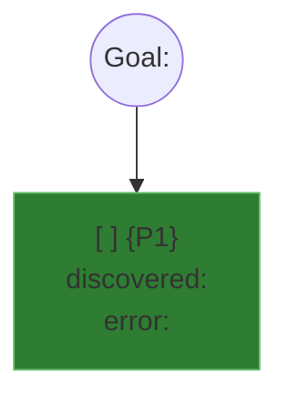

# Mikado Method

Restructure code whose real dependency graph is unknown: try the change, let the compiler and the
tests reveal what it depends on, revert, then build the missing prerequisites bottom-up. The graph
is the artifact; the experiment's code is always thrown away.

**Precondition.** A green safety net exists for the code you touch (characterization or contract
tests). With weak coverage nothing breaks because nothing is checked, and every node looks like a
leaf. Harness verdict CONCERNS or FAIL: stop and strengthen the harness first.

## The loop

1. **Goal**: one business-value sentence agreed with the human ("Admin services deploy without
   customer services"). Refuse a vague goal ("improve the architecture"); ask for a sharper one.
2. **Naive experiment**: in a throwaway worktree (`git worktree add <path> <branch>`), make the
   change the obvious way, no scaffolding. Run the build and the full test suite, harness included.
   Never fix what breaks: the experiment is a sensor.
3. **Visualize**: each failure is a prerequisite. Add it as a node under the goal (or under the
   prerequisite it was found beneath), citing `file:line` and the error message.
4. **Undo**: `git worktree remove <path> --force`. Never `git stash`, never keep almost-working code.

Repeat on each prerequisite until you reach leaves (no pending children). Implement leaves for real
on the actual branch, one at a time, committing green after each. Never start a parent before all
its children are done.

## Graph file

`.copilot-tracking/skraft-plans/{projectSlug}/refactoring/{YYYY-MM-DD}/mikado-<slug>.md`, a Mermaid
`graph TD` in a fenced block. Read [references/graph-format.md](references/graph-format.md) before
writing the first node. Skeleton:

- `[ ]` / `[x]`: pending / done; a leaf turns `[x]` in the same commit as its implementation.
- `observed`: a real experiment failure. `anticipated`: a hypothesis; confirm it with an experiment
  before treating it as a prerequisite.
- Every graph-update commit (creating the file, recording a discovery) is titled
  `refactor(mikado-graph): <what>`; the validator rejects a discovery commit titled otherwise.
- Reload the file from disk before each leaf and after each worker returns.

## Validator (run it, never judge the graph from memory)

Run it after every graph-update commit, before every leaf commit, and before dispatching the next
leaf. `<skill>` is the folder holding this SKILL.md:

- sh (macOS, Linux, Git Bash): `sh "<skill>/scripts/validate-mikado.sh" <graph.md>`
- PowerShell (Windows): `powershell -NoProfile -ExecutionPolicy Bypass -File "<skill>/scripts/validate-mikado.ps1" <graph.md>`

Exit 0: valid, proceed. Exit 1: stop and fix the graph. It checks: a goal node; `discovered:` and
`error:` on every non-anticipated node; every edge targets a defined node; no cycle; each child
discovered in a `refactor(mikado-graph):` commit at or after its parent's; orphans (warning); a
Golden Master node or a `%% no-golden-master: <reason>` comment; then it lists the true leaves ready
for the next dispatch. `--no-git` skips the commit check: use it only on examples with fictional SHAs.

## One leaf per worker

Each leaf goes to a fresh `refactoring-worker`, one dispatch per leaf. The dispatch carries:

1. the graph file path and its full current content;
2. the leaf, verbatim, with its evidence;
3. the acceptance: harness and full regression suite green, no new failure anywhere, change scoped
   to this leaf, leaf marked `[x]` in the leaf commit, validator exit 0 after that commit;
4. "If this leaf has unimplemented prerequisites of its own, stop and report them; do not fix them."

## Terminal signals (worker → refactorer)

- `ADVANCE`: leaf done and committed green; leaves remain.
- `EXPAND`: the leaf has prerequisites of its own; they are reported; nothing was committed.
- `DONE`: a final naive attempt of the goal now succeeds cleanly; no pending node remains.
- `BLOCKED`: needs the human (ambiguous prerequisite, conflicting constraint, harness broken in a
  way the worker cannot diagnose, validator error it cannot resolve).

## Reject

- Keeping experiment code "to clean up later"; always revert and start the leaf fresh.
- Patching during the naive experiment; it corrupts the failure list.
- Running the experiment against a shared environment instead of a throwaway worktree.
- Marking a leaf `[x]` or starting a parent without a clean validator run.

Read [references/worked-example.md](references/worked-example.md) the first time you run this
method in a session.
