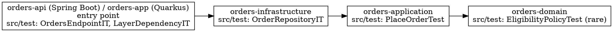

# Clean Architecture Testing — Java (Maven, Spring Boot or Quarkus)

Full runnable examples per layer. Roles and doubles follow the tables in `SKILL.md` — identical across languages, only the library names differ (here: JUnit 5, Mockito, Testcontainers, Spring Boot Test or Quarkus Test, ArchUnit).

## Where the tests live: the Maven convention

Each test sits in the `src/test` of the module it tests. The class name picks the speed:

| Class | Run by | Speed | Holds |
|---|---|---|---|
| `*Test` | Surefire (`mvn test`) | unit | Domain tests (rare), Application acceptance tests, the Cucumber runner of the acceptance scenarios |
| `*IT` | Failsafe (`mvn verify`) | integration | adapters on real containers, API end-to-end, walking skeleton, architecture guard |

A test that starts the application (`@SpringBootTest`, `@QuarkusTest`, `@QuarkusIntegrationTest`) is always an `*IT`, in the entry-point module: the one whose `pom.xml` carries `spring-boot-maven-plugin` or `quarkus-maven-plugin`.



`mvn verify` runs both speeds; the fast loop is `mvn test`. Bind Failsafe once, in the parent `pom.xml`:

```xml
<build>
  <plugins>
    <plugin>
      <groupId>org.apache.maven.plugins</groupId>
      <artifactId>maven-failsafe-plugin</artifactId>
      <executions>
        <execution>
          <goals><goal>integration-test</goal><goal>verify</goal></goals>
        </execution>
      </executions>
    </plugin>
  </plugins>
</build>
```

- **Spring Boot:** `spring-boot-starter-parent` manages the Failsafe version and points it at `target/classes`. Without that parent, add `<configuration><classesDirectory>${project.build.outputDirectory}</classesDirectory></configuration>`: the repackaged jar hides the classes.
- **Quarkus:** keep the Failsafe configuration the Quarkus project generator writes (`systemPropertyVariables`: `java.util.logging.manager`, `maven.home`, `native.image.path`). `@QuarkusIntegrationTest` and the native tests run against the artifact the entry-point module builds, so they live nowhere else.

**Variant — dedicated test modules.** A repository that already has `orders-unit-test` and `orders-integration-test` modules keeps them: the unit module depends on `orders-application`, the integration module on the entry-point module (Spring Boot: set `<classifier>exec</classifier>` on the `repackage` goal so its classes stay visible). Never add a third test module.

## Test layout and executable scenarios

Paths below are relative to the component root (the repository root for a single component).
The four production modules have no `src/test/`. Both test modules group classes by feature.
`orders-unit-test` depends on Application and reaches Domain transitively; the integration
module reaches all four layers through Api. Test-library dependencies have test scope.

| Suite | Feature files | Test code / bindings |
|---|---|---|
| `orders-unit-test` with Cucumber-JVM | `orders-unit-test/src/test/resources/features/<feature>/` | `orders-unit-test/src/test/java/com/example/orders/unittest/<feature>/steps/` |
| `orders-integration-test` | none | `orders-integration-test/src/test/java/com/example/orders/integrationtest/<feature>/`; architecture in `architecture/` |
| Specifications not executed | `docs/features/orders/<feature>/` | none |

For a new JUnit Platform runner, put this suite in
`orders-unit-test/src/test/java/com/example/orders/unittest/RunCucumberTest.java`:

```java
package com.example.orders.unittest;

import org.junit.platform.suite.api.ConfigurationParameter;
import org.junit.platform.suite.api.IncludeEngines;
import org.junit.platform.suite.api.SelectClasspathResource;
import org.junit.platform.suite.api.Suite;
import static io.cucumber.junit.platform.engine.Constants.GLUE_PROPERTY_NAME;

@Suite
@IncludeEngines("cucumber")
@SelectClasspathResource("features")
@ConfigurationParameter(key = GLUE_PROPERTY_NAME, value = "com.example.orders.unittest")
public class RunCucumberTest {}
```

The resource selector reads the feature subfolders; glue is a Java package, not a filesystem
path. Keep bindings below that package and make them call Application use cases, without
booting Spring. Add `cucumber-java`, `cucumber-junit-platform-engine` and
`junit-platform-suite` as test dependencies in the unit-test pom; align Cucumber versions
and JUnit Platform versions with their BOMs, and use Maven Surefire with JUnit Platform support.
Keep the runner's name discoverable (`*Test` here). Run
`mvn -B -q test -pl orders-unit-test -am -Dcucumber.plugin=pretty` and confirm scenarios
and their resolved steps actually execute. Do not rely on Maven's exit code or the suite
class's aggregate test count alone; retain Cucumber's scenario report.

For this runner, the `bdd` entry is:

```json
{ "runner": "cucumber-jvm",
  "features": "orders-unit-test/src/test/resources/features",
  "steps": "orders-unit-test/src/test/java/com/example/orders/unittest" }
```

This one pair covers the runner's feature folders and glue subpackages. Another independently
configured runner needs its own pair. Do not add Cucumber to `orders-integration-test`;
write its API, persistence and architecture checks as ordinary JUnit tests. Keep existing
runner selectors and confirmed paths when extending a repository.

## Domain — pure unit test (rare, extracted rule only)

Only applies when a rule was extracted into a reusable Policy / Specification with a non-trivial edge-case matrix.

```java
class EligibilityPolicyTest {

    @ParameterizedTest
    @CsvSource({"17,0,false", "18,0,true", "25,3,true"})
    void evaluate_appliesAgeAndExperienceRules(int age, int yearsOfExperience, boolean expectedEligible) {
        var result = new EligibilityPolicy().evaluate(new UserInfo(age, yearsOfExperience), new ResourceInfo("standard", 1));

        assertThat(result.isEligible()).isEqualTo(expectedEligible);
    }
}
```

**Not a Domain test:** a single `@Test` asserting `new Money(10, "EUR").amount() == 10`. Delete and rely on usage in Application tests.

## Application — acceptance test (default layer, Mockito)

In `orders-application/src/test`. Sociable test: real domain objects, mocks only on output gateways.

```java
class PlaceOrderTest {

    @Test
    void handle_persistsOrderAndDispatchesEvent() {
        var repository = mock(OrderRepository.class);
        var dispatcher = mock(DomainEventDispatcher.class);
        var handler = new PlaceOrderCommandHandler(repository, dispatcher);

        handler.handle(new PlaceOrderCommand(OrderId.newId(), "Alice"));

        verify(repository).add(argThat(order -> order.customerName().equals("Alice")));
        verify(dispatcher).dispatch(argThat(events ->
                events.stream().anyMatch(OrderPlacedEvent.class::isInstance)));
    }

    @Test
    void handle_whenCustomerNameIsBlank_rejectsBeforePersisting() {
        var repository = mock(OrderRepository.class);
        var handler = new PlaceOrderCommandHandler(repository, mock(DomainEventDispatcher.class));

        assertThatThrownBy(() -> handler.handle(new PlaceOrderCommand(OrderId.newId(), "")))
                .isInstanceOf(DomainException.class);
        verifyNoInteractions(repository);
    }
}
```

Use a hand-written in-memory fake instead of `mock(...)` once more than three tests need the repository to behave as a store (add / find).

## Infrastructure — integration test with Testcontainers

In `orders-infrastructure/src/test`. One container per test class. Real provider, never an in-memory JPA/Hibernate provider.

```java
@Testcontainers
class OrderRepositoryIT {

    @Container
    static final PostgreSQLContainer<?> db = new PostgreSQLContainer<>("postgres:16-alpine");

    private static DataSource dataSource;
    private OrderRepository sut;

    @BeforeAll
    static void migrate() {
        dataSource = new DriverManagerDataSource(db.getJdbcUrl(), db.getUsername(), db.getPassword());
        Flyway.configure().dataSource(dataSource).load().migrate();
    }

    @BeforeEach
    void emptyTables() {
        var jdbc = new JdbcTemplate(dataSource);
        jdbc.execute("TRUNCATE TABLE orders");
        sut = new JdbcOrderRepository(jdbc);
    }

    @Test
    void add_persistsOrder() {
        sut.add(Order.create(OrderId.newId(), "Alice"));

        assertThat(sut.findAll()).extracting(Order::customerName).containsExactly("Alice");
    }

    @Test
    void find_whenOrderMissing_returnsEmpty() {
        assertThat(sut.find(OrderId.newId())).isEmpty();
    }
}
```

## API — end-to-end test (entry-point module)

One happy-path test per endpoint, and the story's walking skeleton, each an `*IT`: the walking skeleton is a plain test, no Gherkin, asserting the status, the shape and one value S1 names. S1's acceptance test stays the Cucumber binding, a `*Test` in the unit-test place.

### Spring Boot — `orders-api/src/test`

```java
@SpringBootTest(webEnvironment = SpringBootTest.WebEnvironment.RANDOM_PORT)
class OrdersEndpointIT {

    @Autowired
    private TestRestTemplate client;

    @Test
    void postOrders_withValidBody_returns201() {
        var response = client.postForEntity("/orders", new PlaceOrderRequest("Alice"), Void.class);

        assertThat(response.getStatusCode()).isEqualTo(HttpStatus.CREATED);
        assertThat(response.getHeaders().getLocation()).isNotNull();
    }

    @Test
    void getOrder_whenMissing_returns404() {
        var response = client.getForEntity("/orders/" + UUID.randomUUID(), Void.class);

        assertThat(response.getStatusCode()).isEqualTo(HttpStatus.NOT_FOUND);
    }
}
```

Point `spring.datasource.*` at a Testcontainers database via `@ServiceConnection` (or `@DynamicPropertySource`).

### Quarkus — `orders-app/src/test`

```java
@QuarkusTest
class OrdersEndpointIT {

    @Test
    void postOrders_withValidBody_returns201() {
        given().contentType(ContentType.JSON).body(new PlaceOrderRequest("Alice"))
                .when().post("/orders")
                .then().statusCode(201).header("Location", notNullValue());
    }

    @Test
    void getOrder_whenMissing_returns404() {
        when().get("/orders/" + UUID.randomUUID()).then().statusCode(404);
    }
}

@QuarkusIntegrationTest
class PackagedOrdersEndpointIT extends OrdersEndpointIT {
    // the same checks against the built jar or native executable
}
```

Leave the datasource URL unset in the `test` profile: Dev Services starts the database container. A test that needs its own container setup uses `@QuarkusTestResource` with a `QuarkusTestResourceLifecycleManager`.

On either framework, downstream HTTP calls to external APIs → route them to a contract mock server (Microcks).

## Architecture guard

In the entry-point module, `orders-api/src/test` or `orders-app/src/test` (test scope: `com.tngtech.archunit:archunit-junit5:1.4.0`).

```java
package com.example.orders.architecture;

import static com.tngtech.archunit.core.domain.JavaClass.Predicates.resideInAPackage;
import static com.tngtech.archunit.lang.syntax.ArchRuleDefinition.classes;
import static com.tngtech.archunit.library.dependencies.SlicesRuleDefinition.slices;
import static org.assertj.core.api.Assertions.assertThat;

import com.tngtech.archunit.base.DescribedPredicate;
import com.tngtech.archunit.core.domain.JavaClasses;
import com.tngtech.archunit.core.importer.ClassFileImporter;
import com.tngtech.archunit.core.importer.ImportOption;
import java.nio.file.Files;
import java.nio.file.Path;
import java.util.List;
import java.util.regex.Pattern;
import org.junit.jupiter.api.Test;
import org.junit.jupiter.params.ParameterizedTest;
import org.junit.jupiter.params.provider.CsvSource;

class LayerDependencyIT {

    private static final String ROOT = "com.example.orders";
    private static final Pattern INTERNAL_DEPENDENCY = Pattern.compile(
            "<dependency>(?:(?!</dependency>).)*?<artifactId>(orders-[a-z-]+)</artifactId>", Pattern.DOTALL);
    private static final JavaClasses PRODUCTION = new ClassFileImporter()
            .withImportOption(ImportOption.Predefined.DO_NOT_INCLUDE_TESTS)
            .importPackages(ROOT);

    @ParameterizedTest
    @CsvSource({"orders-domain,", "orders-application, orders-domain",
                "orders-infrastructure, orders-application", "orders-api, orders-infrastructure"}) // Quarkus: orders-app
    void each_module_references_only_its_inner_neighbour(String module, String allowed) throws Exception {
        var pom = Files.readString(root().resolve(module).resolve("pom.xml"));
        var internal = INTERNAL_DEPENDENCY.matcher(pom).results().map(match -> match.group(1)).toList();
        assertThat(internal).containsExactlyInAnyOrderElementsOf(allowed == null ? List.of() : List.of(allowed));
    }

    @Test
    void domain_depends_only_on_itself_and_the_jdk_core() {
        onlyDependOn("domain", "domain");
    }

    @Test
    void application_depends_only_on_inner_layers_and_the_jdk_core() {
        onlyDependOn("application", "application", "domain");
    }

    // One application feature never uses another; the shared package is for what two features need.
    @Test
    void application_features_do_not_depend_on_each_other() {
        slices().matching(ROOT + ".application.(*)..")
                .should().notDependOnEachOther()
                .ignoreDependency(DescribedPredicate.alwaysTrue(), resideInAPackage(ROOT + ".application.shared.."))
                .check(PRODUCTION);
    }

    // JDK core without I/O, network or persistence.
    private static void onlyDependOn(String layer, String... allowedLayers) {
        var allowed = new java.util.ArrayList<>(List.of("java.lang..", "java.util..", "java.time..", "java.math.."));
        for (var allowedLayer : allowedLayers) allowed.add(ROOT + "." + allowedLayer + "..");
        classes().that().resideInAPackage(ROOT + "." + layer + "..")
                .should().onlyDependOnClassesThat().resideInAnyPackage(allowed.toArray(String[]::new))
                .check(PRODUCTION);
    }

    private static Path root() {
        var directory = Path.of("").toAbsolutePath();
        while (!Files.exists(directory.resolve("orders-domain"))) directory = directory.getParent();
        return directory;
    }
}
```

| Change | Guard |
|---|---|
| `orders-api` → `orders-application` reference | red |
| Domain/Application imports `org.springframework..`, `io.quarkus..`, `jakarta..`, `com.fasterxml.jackson..` | red |
| Domain/Application uses `java.net.http.HttpClient`, `java.nio.file.Files`, `java.sql..` | red |
| `…application.refund` imports `…application.authorization.PaymentGateway` | red |
| Infrastructure imports Domain types; Api imports Application use cases (transitive) | green |

`layeredArchitecture().consideringOnlyDependenciesInLayers()` alone stays green on both leaks: add it only on top of the allow-list.
