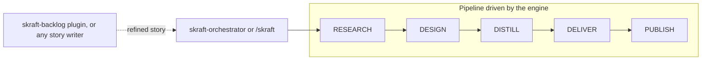

# SKRAFT plugin

Deterministic agentic software delivery for Claude Code, GitHub Copilot CLI and VS Code.

Give SKRAFT one refined story. Specialist agents research it, design it, turn it into
acceptance tests and deliver tested code; read-only review lenses challenge each phase. The
**skraft engine**, not the model's goodwill, decides every step: phase order, expected outputs,
write scope, gates, review verdict and the commits of each TDD cycle. It runs the same way on
every host, on Windows, macOS and Linux, and costs nothing per tool call: the plugin ships no
command hooks.

## Why SKRAFT

- **Phases you can trust.** The engine starts an agent only when its inputs exist, pre-creates
  its outputs, checks them afterwards, and refuses a step that wrote outside its scope (git
  diff after each step).
- **Proof, not claims.** Build, format, lint, tests, architecture, coverage and mutation run
  from the commands in `skraft-config.json`; the engine writes the evidence. A red TDD commit
  is replayed to confirm it really fails.
- **Craft by default.** Outside-In TDD, BDD, Clean Architecture per stack, contract testing,
  ADRs and mutation testing ship as skills the agents read before they start.
- **Resumable and tamper-evident.** Every fact of a run lands in a hash-chained, signed
  journal in your repository; a run stops on a hand-edited journal and resumes exactly where
  it stopped.

## Install

**Claude Code**, inside Claude Code:

```text
/plugin marketplace add SebastienDegodez/skraft-plugin
/plugin install skraft
```

**GitHub Copilot CLI**: install `skraft` from this repository's marketplace, or load
`plugins/skraft-framework` with `--plugin-dir` for local development.

**VS Code**: find `skraft` under `@agentPlugins` in the Extensions view, or register a clone
with `chat.pluginLocations`.

Prerequisites: Node 22 or later and Git. `gh` is needed only to open the pull request at the
end of a run. Step by step, and how to check the host sees the plugin:
[Install skraft on a host](https://sebastiendegodez.github.io/skraft-plugin/en/how-to/install-on-a-host); a first guided run:
[First steps](https://sebastiendegodez.github.io/skraft-plugin/en/tutorials/getting-started).

## Set up a repository

`skraft` below stands for `node "<plugin folder>/engine/drivers/cli/skraft.mjs"`, run from the
root of the working copy. The same line works under sh and PowerShell.

```text
skraft init             detect one component per project into skraft-config.json
skraft doctor --run     run each command once and say which one fails, and which VS Code driver applies
```

`skraft-config.json` lists your **components**: root, stack, source and test paths, and the
commands skraft runs (build, format, lint, test, architecture, coverage, mutation, e2e). A
component can live in another repository (`"root": "../payment-web"`). A command you write
always wins over a default; quality thresholds are not configurable. How-to:
[Configure components](https://sebastiendegodez.github.io/skraft-plugin/en/how-to/configure-components); every field:
[skraft-config.json](https://sebastiendegodez.github.io/skraft-plugin/en/reference/skraft-config).

## Run a story

| Host | Start or resume a run | Answer a question | Follow the run |
|---|---|---|---|
| Claude Code | `/skraft <slug> [#issue] [title]`, or ask `skraft-orchestrator` | the dialog, the pane's buttons, or `/skraft decide <answer>` | the Skraft pane, `/skraft` |
| Copilot CLI | select `skraft:skraft-orchestrator`; it runs the `skraft-pipeline` workflow | the host's confirmation, else `skraft decide` in a terminal | the workflow log, `skraft status` |
| VS Code | `node "<plugin folder>/engine/drivers/copilot-sdk/skraft-run.mjs" <slug>` in a terminal; without the Copilot SDK, ask `skraft-orchestrator`, which conducts `skraft next` / `skraft record` | `skraft decide` in a terminal | `skraft status`, `WORKFLOW.md` |

Without a slug, the run resumes the working copy's active pipeline. One session drives a
pipeline at a time: a second one is refused while the first holds the run's lease. Each host in
detail: [Hosts](https://sebastiendegodez.github.io/skraft-plugin/en/reference/hosts); resuming or unblocking a run:
[Resume a run](https://sebastiendegodez.github.io/skraft-plugin/en/how-to/resume-a-run).



| Phase | Specialist | Review lenses (verdict computed by the engine) | Result |
|---|---|---|---|
| `RESEARCH` | `solution-researcher` | — | Research document and constraints |
| `DESIGN` | `solution-architect` | consistency, architecture-compliance, fitness; then you ratify the ADRs | ADRs, contracts, implementation shape |
| `DISTILL` | `acceptance-designer` | coverage, business-alignment, testability, boundary-enforcement | Gherkin scenarios, test plan, failing acceptance tests |
| `DELIVER` | `software-engineer` | after the gates, before mutation: test-integrity, architecture-boundaries, cold-reader, mock-fidelity, contract-fidelity; test-integrity again on mutant kills | Tested code, gate evidence, red/green commits |
| `PUBLISH` | `pr-writer` | — | The branch's pull request, with screenshots of a front end |

A `NEEDS_REWORK` verdict sends the work back to its specialist with the confirmed findings;
every loop has a ceiling. A `finding-refuter` checks each blocker, high and medium finding
before it counts, and a re-review only asks again the lenses whose inputs changed.

The pipeline is a DOT graph, `workflows/pipeline.skraft.dot`, and the DELIVER review a second
one, `workflows/review.skraft.dot`. `skraft workflow eject` copies them into `.skraft/` of your
repository, where you can add an agent, a lens, a gate or a question. DELIVER gates are locked
and the reviews mandatory: a copy cannot drop them silently. Inputs, outputs and decisions of
each phase: [Phases](https://sebastiendegodez.github.io/skraft-plugin/en/reference/phases); the graph syntax:
[DOT workflow](https://sebastiendegodez.github.io/skraft-plugin/en/reference/workflow-dot); adapting it:
[Copy and adapt the workflow](https://sebastiendegodez.github.io/skraft-plugin/en/how-to/eject-workflow).

## What the engine guarantees

| Check | What you get |
|---|---|
| Phase order and inputs | An agent starts only when the workflow reaches it, with every input it needs in its brief |
| Expected outputs | Each output is pre-created from its template; a missing or invalid one is asked again with what was wrong, up to three attempts, and the same failure twice stops the run |
| Write scope | After each step, the git diff is compared with what that agent may write; a step outside it is refused |
| Gates | DELIVER closes only when the commands of `skraft-config.json` pass; mutation must reach 100 % on Domain and Application, 80 % elsewhere |
| TDD | A red commit whose tests pass, or a green commit with no red before it, is refused |
| Review verdict | Lenses return typed findings; the engine refutes, counts and decides |
| Human decisions | A question waits for a person's answer; under Copilot, only a host-confirmed answer is recorded |
| Journal | `events.jsonl` is hash-chained and signed with a key of your machine; a hand edit stops the run |

## Where the work lives

```text
.copilot-tracking/skraft-plans/
├── .active-slug               the active pipeline of this working copy
└── <slug>/
    ├── events.jsonl           hash-chained, signed journal: the run's state is derived from it
    ├── research/ … docs       the phase documents the agents write
    ├── reviews/  gates/       review passes and gate evidence, written by the engine
    ├── WORKFLOW.md            the workflow graph with where the run stands
    ├── run-report.md          time, cost and retries of each step
    ├── qa-report.md           test plan, gates, mutation, red commits, verdicts, for a QA team
    └── pull-request.md        the pull request description
```

Read it through the command line rather than by hand: `skraft status`, `skraft report`. A
journal started on another machine is adopted with `skraft journal adopt`. Every file, event and
refusal code: [Tracking and journal](https://sebastiendegodez.github.io/skraft-plugin/en/reference/run-journal).

## Models

Each agent runs on a model **family**: a tier (`economy`, `standard`, `frontier`) or a role
(`reviewer`, `researcher`, `implementer`, `planner`). `assign` in `skraft-config.json` (or in
`~/.skraft/config.json`, or an uncommitted `skraft-config.local.json`) picks each agent's family;
`models` says what a family runs on per host, with an effort. `skraft doctor` shows the
resolved assignment. How-to: [Choose the agents' models](https://sebastiendegodez.github.io/skraft-plugin/en/how-to/choose-models).

## Supported stacks

| Stack | Clean Architecture | Quality gates and mutation | Mocking and contract tests |
|---|---|---|---|
| .NET | `clean-architecture-dotnet` | `quality-gates-dotnet` (Stryker.NET) | Microcks (default) or in-process doubles; `WebApplicationFactory` |
| Python | `clean-architecture-python` | `quality-gates-python` (cosmic-ray) | Microcks (default) or respx; FastAPI `TestClient` |
| Java / Spring Boot | `clean-architecture-java` | not yet | not yet |
| TypeScript back end (Node, Vitest) | `clean-architecture-typescript` | `quality-gates-typescript` (StrykerJS on Vitest) | MSW (default) or Microcks |
| React / TypeScript (Vitest) | `clean-architecture-react` | `quality-gates-typescript` (StrykerJS on Vitest) | MSW (default) or Microcks; no contract test, a front end exposes no API |
| Node JavaScript | — | `quality-gates-javascript` (`node --test`, StrykerJS TAP) | MSW (default) or Microcks |

Contract testing is off by default; a component turns it on with `"contractTesting": true`. In
DELIVER, a component needs at least one gate command and a `mutation` command; without them the
gate fails with a named reason (class `environment`): SKRAFT never guesses a command.

## Pull request at the end of a run

The run ends by pushing the branch and opening a draft pull request, or updating it. SKRAFT asks
your consent once per repository and keeps it in `skraft-config.json` under `publish`. The
`pr-writer` agent writes the summary; the engine renders the rest from the journal (gates,
mutation, verdicts, ADRs). For a front end, the screenshots of its Playwright run are committed
and shown in the pull request, after a separate consent. With your consent, a run started from an
issue keeps one progress comment on that issue. Without consent, a remote or `gh`, the description stays in
`pull-request.md` and `skraft publish` opens the pull request later. How-to:
[Publish the pull request](https://sebastiendegodez.github.io/skraft-plugin/en/how-to/publish-pull-request).

## Review any pull request

`skraft review --pr <number>` runs the DELIVER review workflow on one pull request, with no
skraft run: checked out at its head, it reads the workflow, the configuration and the project
rules from the pull request's base, runs the lenses and the refuter, and prints the verdict.
`--publish` keeps that verdict in one comment of the pull request, after your consent. Under
Copilot CLI, the `skraft-review` workflow does the same. How-to:
[Review a pull request with skraft](https://sebastiendegodez.github.io/skraft-plugin/en/how-to/review-a-pull-request).

## Coming from v1

`skraft migrate` converts a working copy left by v1: `skraft-config.json` to the components
format, and each v1 run in progress into a signed journal that resumes at its current phase,
`state.json` left untouched. `--dry-run` shows what it would write. How-to:
[Migrate a working copy from v1](https://sebastiendegodez.github.io/skraft-plugin/en/how-to/migrate-from-v1).

## Other plugins

- **Product:** [skraft-backlog](../skraft-backlog/README.md): `backlog-discoverer` and
  `backlog-planner` turn a need into refined stories. Any story with acceptance criteria works
  as well.
- **Brownfield:** [skraft-brownfield](../skraft-brownfield/README.md): `brownfield-analyst`
  characterizes an existing system, `brownfield-harness-builder` pins its behaviour with tests
  and contracts, `brownfield-refactorer` modernizes it step by step (Mikado, Strangler Fig).

## Documentation

- [SKRAFT handbook](https://sebastiendegodez.github.io/skraft-plugin/en/) (FR and EN), including the
  [command line](https://sebastiendegodez.github.io/skraft-plugin/en/reference/cli), the [architecture](https://sebastiendegodez.github.io/skraft-plugin/en/explanation/architecture) and the
  [agent and skill catalogue](https://sebastiendegodez.github.io/skraft-plugin/en/dashboard/)
- [Repository architecture](https://github.com/SebastienDegodez/skraft-plugin/blob/main/docs/architecture.md)
- [Maintaining the plugin](MAINTAINING.md): packaging, agent sync, checks before a PR
- [Contributing rules](https://github.com/SebastienDegodez/skraft-plugin/blob/main/AGENTS.md)

## License

GPL-3.0-or-later. See the
[repository license](https://github.com/SebastienDegodez/skraft-plugin/blob/main/LICENSE).
