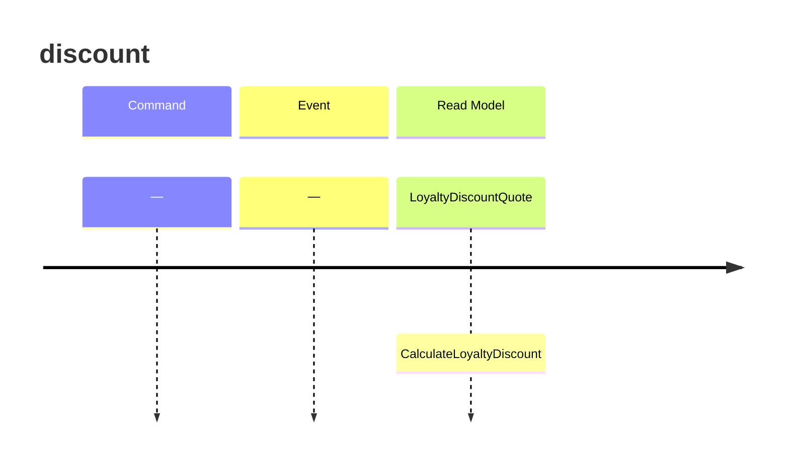

<!-- markdownlint-disable-file -->
# Event model — checkout-pricing

## Slice: discount

| Step | Kind | Name | Holds |
|---|---|---|---|
| Trigger | Query | `CalculateLoyaltyDiscount` | `SubtotalCents`, `LoyaltyTier` |
| Outcome | Read Model | `LoyaltyDiscountQuote` | `SubtotalCents`, `DiscountCents`, `TotalCents`, `LoyaltyTier` |

`CalculateLoyaltyDiscount` is a pure read: it raises no Domain Event. Its handler,
`CheckoutPricing.Application.CalculateLoyaltyDiscount.Handle`, is the only use case the outer loop
drives. `LoyaltyDiscountQuote.TotalCents` is what the customer is charged: the observable the
acceptance criteria talk about.

