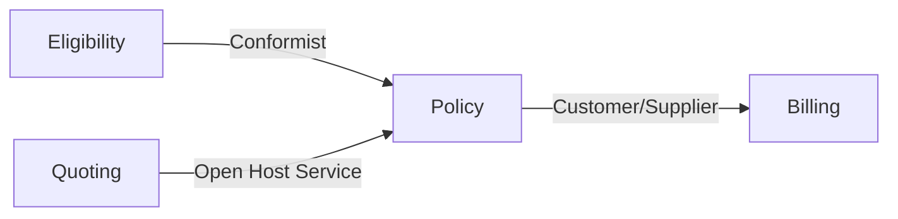

# Context map

| Upstream | Downstream | Relationship | Why |
|---|---|---|---|
| Eligibility | Policy | Conformist | Policy uses Eligibility's result shape as is; both teams sit together |
| Quoting | Policy | Open Host Service | Policy binds a quote through Quoting's published quote contract |
| Policy | Billing | Customer/Supplier | Billing schedules premiums from issued policies |
