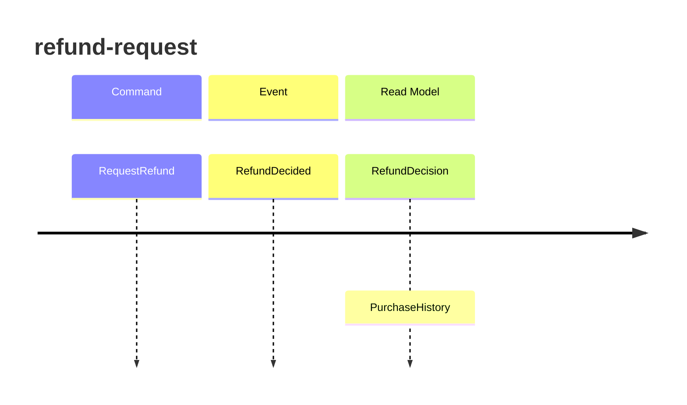

<!-- markdownlint-disable-file -->
# Event model — returns

## Slice: refund-request

| Step | Kind | Name | Fields |
|---|---|---|---|
| Trigger | Command | `RequestRefund` | `PurchaseId: identifier`, `RequestedOn: date` |
| State change | Domain Event | `RefundDecided` | `PurchaseId: identifier`, `Outcome: Refunded \| Declined`, `AmountRefunded: decimal amount`, `Reason: text` |
| Outcome | Read Model | `RefundDecision` | `PurchaseId: identifier`, `Outcome: Refunded \| Declined`, `AmountRefunded: decimal amount`, `Reason: text` |
| Trigger | Query | `GetPurchaseHistory` | `PurchaseId: identifier` |
| Outcome | Read Model | `PurchaseHistory` | `PurchaseId: identifier`, `PricePaid: decimal amount`, `BoughtOn: date`, `AlreadyRefunded: yes/no` |

Observed: `RefundDecision.Outcome`, `RefundDecision.AmountRefunded`, `RefundDecision.Reason`.

`RequestRefund` and `GetPurchaseHistory` are the two use cases of the Returns application layer;
they are the only boundaries the team drives the refund behaviour from.
`RefundDecision.Outcome`, `RefundDecision.AmountRefunded` and `RefundDecision.Reason` carry
everything the business talks about. `PurchaseHistory.AlreadyRefunded` records that a purchase
has been refunded once. The return period and the refunded-once rule are business policy.

