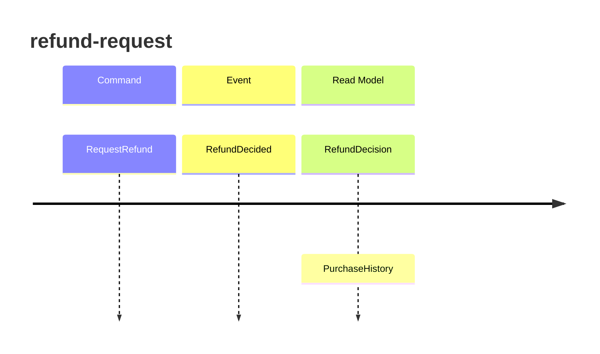

<!-- markdownlint-disable-file -->
# Event model — returns

## Slice: refund-request

| Step | Kind | Name | Holds |
|---|---|---|---|
| Trigger | Command | `RequestRefund` | `PurchaseId`, `RequestedOn` |
| State change | Domain Event | `RefundDecided` | `PurchaseId`, `Outcome`, `AmountRefunded`, `Reason` |
| Outcome | Read Model | `RefundDecision` | `PurchaseId`, `Outcome`, `AmountRefunded`, `Reason` |
| Trigger | Query | `GetPurchaseHistory` | `PurchaseId` |
| Outcome | Read Model | `PurchaseHistory` | `PurchaseId`, `PricePaid`, `BoughtOn`, `AlreadyRefunded` |

`RequestRefund` and `GetPurchaseHistory` are the two use cases of the Returns application layer;
they are the only boundaries the team drives the refund behaviour from.
`RefundDecision.Outcome`, `RefundDecision.AmountRefunded` and `RefundDecision.Reason` carry
everything the business talks about. `PurchaseHistory.AlreadyRefunded` records that a purchase
has been refunded once. The return period and the refunded-once rule are business policy.

